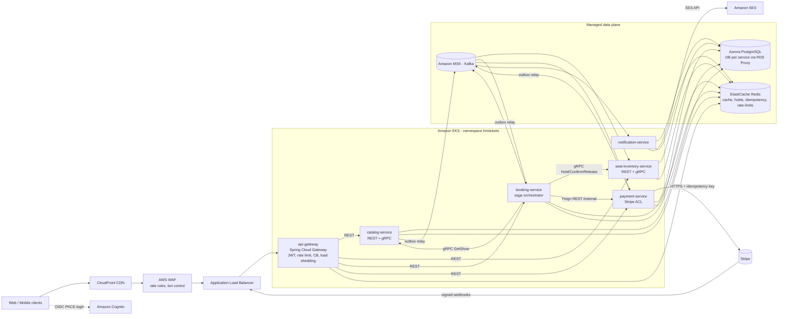
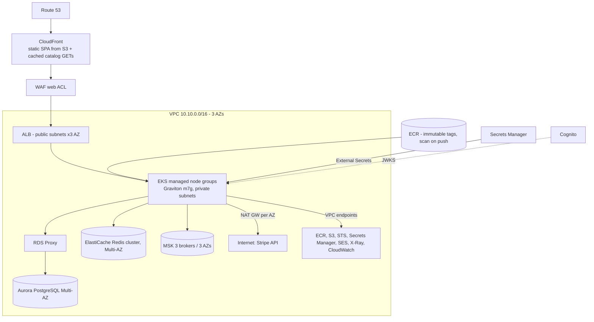
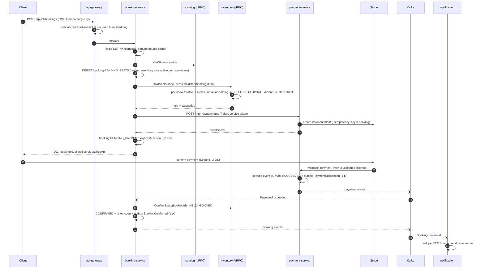
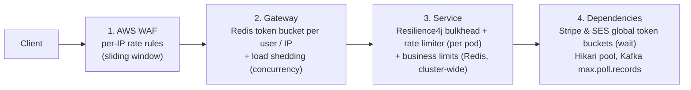

# BookMyTickets - Architecture & Design Decisions

> Enterprise ticket-booking platform (movies, concerts, sports) built as Java 21 / Spring Boot 3.5 microservices,
> packaged as Docker images in Amazon ECR and run on Amazon EKS.
> Companion document: [MICROSERVICE-PATTERNS.md](MICROSERVICE-PATTERNS.md) explains every pattern used and where it lives in the code.

---

## 1. Goals and scale assumptions

| Dimension | Target | Design consequence |
|---|---|---|
| Registered users | 10M+ | Stateless services, managed identity (Cognito) |
| Peak concurrent users (big on-sale) | ~500k | Edge caching, horizontal autoscaling, load shedding |
| Read traffic (browse, seat maps) | ~50k req/s peak | CDN + Redis cache-aside + 2s seat-map micro-cache |
| Booking attempts | ~5k/s peak, extreme contention on a few seats | Redis atomic holds in front of DB row locks, per-show admission throttle |
| Correctness | **Zero double-sold seats, zero double charges** | Layered concurrency control, idempotency everywhere, saga + outbox |
| Availability | 99.95% | 3 AZs, PDBs, circuit breakers, graceful degradation |
| Latency | p99 < 300ms browse, < 1.5s create booking | gRPC internally, caching, virtual threads |

---

## 2. High-level architecture

### Services

| Service | Responsibility | Inbound | Outbound | Data |
|---|---|---|---|---|
| **api-gateway** | Single entry point: routing, JWT validation, distributed rate limiting, load shedding, circuit breaking, CORS | ALB | all public services (REST) | Redis (rate-limit buckets) |
| **catalog-service** | Venues, events, shows, prices | REST (public GET, admin POST), gRPC `GetShow` | Kafka `ShowScheduled` | Postgres `catalog_db`, Redis cache |
| **seat-inventory-service** | Seat map, seat holds, double-booking prevention | REST seat map, gRPC `HoldSeats/ConfirmSeats/ReleaseSeats` | - | Postgres `inventory_db`, Redis holds |
| **booking-service** | Booking lifecycle, saga orchestration, idempotency, ticket codes | REST `/api/v1/bookings`, Kafka `payment.events` | gRPC catalog/inventory, Feign payment, Kafka `booking.events`, `payment.commands` | Postgres `booking_db`, Redis |
| **payment-service** | PSP integration (Stripe) behind an anti-corruption layer, webhooks, refunds | REST `/internal/payments` (service token), Stripe webhooks, Kafka `payment.commands` | Stripe API, Kafka `payment.events` | Postgres `payment_db` |
| **notification-service** | Ticket confirmation / cancellation e-mails | Kafka `booking.events` | Amazon SES | Postgres `notification_db` (dedup log) |
| **discovery-server** | Eureka registry - **local/docker only** | - | - | - |

---

## 3. Technology choices - what and why

| Concern | Choice | Why (benefit) | Alternatives considered |
|---|---|---|---|
| Language/runtime | **Java 21 LTS** + **virtual threads** | Blocking, readable code that scales like async: a parked virtual thread costs bytes, not an OS thread, so thousands of concurrent I/O-bound requests per pod | Reactive everywhere (harder to read/debug, poor JDBC/JPA fit) |
| Framework | **Spring Boot 3.5** | Mature ecosystem: security, data, Kafka, actuator, observability; huge talent pool | Quarkus/Micronaut (faster startup, smaller ecosystem) |
| Cloud patterns | **Spring Cloud 2025.0** (Gateway, OpenFeign, LoadBalancer, CircuitBreaker, Kubernetes) | Standard building blocks for gateway, discovery, client LB, declarative clients | Istio for everything (more ops burden) |
| API gateway | **Spring Cloud Gateway (WebFlux)** in-cluster, behind **ALB + WAF** | Non-blocking (Netty) edge that can hold 10k+ open connections per pod; Java-programmable filters (rate limiting by JWT user, load shedding); WAF/ALB handle TLS and volumetric attacks | Amazon API Gateway (per-request cost at 50k rps, 29s timeout, less control over per-user Redis limits) |
| Internal sync calls | **gRPC** (booking -> catalog/inventory), **OpenFeign** (booking -> payment) | gRPC: binary protobuf over HTTP/2, strict contracts, deadlines, ~5-10x smaller payloads on the hottest path. Feign: declarative REST where the payload is small and the API is also consumed by humans/tools | REST everywhere (simpler, slower); gRPC everywhere (harder for webhooks/browsers) |
| Async messaging | **Apache Kafka (Amazon MSK)** | Durable, partitioned, replayable log; per-key ordering (bookingId); consumer groups scale horizontally; retry/DLT topics | SQS/SNS (simpler, no ordering per key without FIFO limits, no replay); RabbitMQ |
| Database | **PostgreSQL (Aurora)**, one DB per service, **RDS Proxy** | ACID transactions, row locks, partial unique indexes (duplicate-booking guard), `SKIP LOCKED` (outbox). Aurora: 6-way replicated storage, fast failover, read replicas. RDS Proxy multiplexes connections from hundreds of pods | DynamoDB (great scale, but conditional multi-item seat holds and relational reporting are harder) |
| Cache / coordination | **Redis (ElastiCache cluster mode)** | Sub-ms atomic Lua scripts for seat holds, idempotency keys, token buckets and scheduler locks; cache-aside for catalog | Memcached (no scripts/atomic ops) |
| Schema migrations | **Flyway** | Versioned, repeatable, runs at startup; `ddl-auto=validate` guards drift | Liquibase |
| Resilience | **Resilience4j** | Circuit breaker, retry w/ jitter, bulkhead, rate limiter, time limiter - annotation-driven, Micrometer metrics | Hystrix (EOL) |
| Identity | **Amazon Cognito** (prod) / **Keycloak** (local), OAuth2/OIDC JWT | Managed MFA, social login, PKCE, client-credentials for services; standard JWT validated with JWKS by every service | Custom auth service (undifferentiated heavy lifting) |
| Payments | **Stripe** PaymentIntents behind a `PaymentGateway` port | SCA/3-DS handled client-side by Stripe.js, PCI scope minimised (card data never touches us), idempotency keys, signed webhooks | Razorpay/Adyen - pluggable via the same port |
| E-mail | **Amazon SES** | High-volume, cheap, IAM-native (IRSA, no SMTP passwords) | SendGrid |
| Discovery | **Kubernetes API** (Spring Cloud Kubernetes) on EKS; **Eureka** locally | On EKS the platform already knows every healthy pod - no extra registry to run/scale/secure; Eureka keeps the same `lb://` code working on a laptop | Consul; Eureka in prod (duplicate source of truth) |
| Observability | **Micrometer + OpenTelemetry** -> ADOT -> **X-Ray**, **Amazon Managed Prometheus/Grafana**, JSON logs -> **CloudWatch** | Vendor-neutral instrumentation (OTLP); trace ids in every log line; Kafka/gRPC/Feign/JDBC spans propagate automatically | Datadog/New Relic agents |
| Containers | Multi-stage Dockerfile, Spring Boot **layered jars**, non-root, multi-arch (amd64 + **Graviton arm64**) | Small, cache-friendly images, ~20% better price/performance on Graviton | Jib/Buildpacks (fine alternatives) |
| Orchestration | **Amazon EKS** + Kustomize, HPA, KEDA, PDB, NetworkPolicy, External Secrets, IRSA | Portable Kubernetes, fine-grained autoscaling (CPU and Kafka lag), zero-trust networking, no static AWS keys | ECS Fargate (simpler, less ecosystem) |

---

## 4. AWS deployment architecture

| Layer | AWS service | Configuration highlights |
|---|---|---|
| DNS / CDN | Route 53, CloudFront | SPA from S3; `Cache-Control: public, max-age=30` on catalog GETs lets CloudFront absorb browse traffic |
| Edge security | AWS WAF, Shield Standard | Rate-based rules per IP, managed OWASP + bot-control rule groups (`k8s/aws/waf-web-acl.json`) |
| Load balancing | ALB (via AWS Load Balancer Controller) | TLS 1.3 policy, HTTP/2, IP targets (straight to pods), 30s deregistration delay |
| Compute | EKS 1.33, managed node groups (Graviton), Cluster Autoscaler/Karpenter | 3 AZs, private nodes, Pod Security "restricted" |
| Images | ECR | Immutable tags, scan on push, KMS, lifecycle policy |
| Relational data | Aurora PostgreSQL + RDS Proxy | One logical DB per service (separate clusters for the hottest: inventory, booking) |
| Cache/locks | ElastiCache Redis (cluster mode, TLS, Multi-AZ) | `noeviction` for the holds/idempotency cluster; separate cache cluster optional |
| Messaging | MSK | RF 3, `min.insync.replicas=2`, producers `acks=all`, idempotent producers |
| Identity | Cognito | User pool (PKCE SPA client), resource server `bmtickets` with scope `internal`, M2M client for booking-service |
| Secrets | Secrets Manager + External Secrets Operator | Rotation, CloudTrail audit, nothing secret in Git/images |
| E-mail | SES | Verified domain, DKIM, configuration set -> SNS bounces/complaints |
| Observability | ADOT collector, X-Ray, AMP, AMG, CloudWatch Logs/Container Insights | Alarms on p99 latency, 5xx, circuit-breaker state, DLT counters, rate-limit rejections |

---

## 5. Communication design (sync vs async)

| Interaction | Style | Protocol | Why |
|---|---|---|---|
| Client -> platform | Sync | HTTPS REST/JSON | Browser/mobile friendly, cacheable at CDN |
| Booking -> Catalog (show + prices) | Sync | **gRPC** | User is waiting, needs the answer now; hot path benefits from protobuf/HTTP2 |
| Booking -> Inventory (hold/confirm/release) | Sync | **gRPC** | Need immediate "seats are yours / not available" answer; commands idempotent on bookingId |
| Booking -> Payment (create/cancel intent) | Sync | **REST via OpenFeign** | Client needs `clientSecret` immediately to open the Stripe payment sheet |
| Stripe -> Payment | Async callback | HTTPS webhook (HMAC-signed) | Payment completion happens in the user's browser (3-DS), we learn about it out-of-band |
| Payment -> Booking (succeeded/failed/refunded) | **Async** | Kafka `payment.events` | Decouples payment from booking; survives booking-service downtime; replayable |
| Booking -> Payment (refund command) | **Async** | Kafka `payment.commands` | Compensation must eventually happen even if payment-service is down now |
| Catalog -> Inventory (show scheduled) | **Async** | Kafka `catalog.show-events` | Seat-map generation (thousands of rows) shouldn't block the admin request |
| Booking -> Notification (ticket e-mail) | **Async** | Kafka `booking.events` | E-mail latency/outages must never affect booking; retry topics + DLT |

Rule of thumb applied: **synchronous only when the caller cannot proceed without the answer; everything else is an event.**

---

## 6. The booking flow end to end

**Failure paths (compensations):**

| Failure | Handling |
|---|---|
| Seats taken | Booking `FAILED`, 409 with `unavailableSeats` |
| Inventory/payment down (circuit open) | Release seats (best effort), booking `FAILED`, 503 + `Retry-After` |
| User never pays | `BookingExpiryJob` (ShedLock) cancels PaymentIntent, releases seats, `EXPIRED`, e-mail |
| Paid at the last second | Cancel returns `ALREADY_SUCCEEDED` -> reconcile -> confirm instead of expire |
| Payment arrives for expired booking / seats lost | `RefundRequested` command -> payment-service refunds (idempotent) |
| Abandoned holds (crash anywhere) | Redis TTL + inventory sweeper return seats to the pool |
| Poison Kafka message | retries with back-off -> `<topic>.DLT`, alarm |

---

## 7. Concurrency control: no double booking, ever

Seat contention is the hardest problem in ticketing: 50k people may click the same front-row seats within the
same second. Five independent layers make overselling impossible while keeping the database calm:

| # | Layer | Where | What it stops |
|---|---|---|---|
| 1 | **Per-user idempotency key** (Redis `SET NX` + DB unique `(user_id, idempotency_key)`) | booking-service `IdempotencyService` | Double click, client/network retries creating two bookings |
| 2 | **One active booking per user per show** (partial unique index) | `booking` table `uk_booking_active_user_show` | Two tabs / bots holding many seat sets at once |
| 3 | **Per-show admission throttle** (distributed token bucket) | inventory `SeatReservationService` | A flash-sale stampede overwhelming Redis/DB for one show |
| 4 | **Redis atomic multi-seat hold** (Lua, all-or-nothing, `{showId}` hash tag, TTL) | `hold_seats.lua`, `SeatHoldCache` | 99% of contention rejected in ~1 ms without touching Postgres |
| 5 | **DB pessimistic lock in deterministic order + state machine + `@Version` + unique (show, seat)** | `SeatRepository.lockSeats`, `Seat.isHoldableBy` | Everything else - **the source of truth**. Ordered locking prevents deadlocks; `lock_timeout=3s` bounds waits |

Why both Redis and the DB? Redis replication is asynchronous; after a failover a hold key might be missing. The DB
check guarantees correctness anyway, while Redis guarantees that the DB only sees the (rare) requests that might win.

All seat operations are **idempotent on `holdRef` (= bookingId)**: a timed-out gRPC call can be retried safely
because "hold again by the same booking" and "confirm an already-booked seat by the same booking" both succeed.

---

## 8. Idempotency (API, messaging, payments)

| Boundary | Mechanism |
|---|---|
| Client -> booking API | Mandatory `Idempotency-Key` header; Redis record `IN_PROGRESS -> COMPLETED(response)`; same key + different body -> 422; concurrent duplicate -> 409; replay -> same 201 body + `Idempotent-Replayed: true` |
| Booking -> inventory | `holdRef = bookingId` makes hold/confirm/release repeatable |
| Booking -> payment | `payment.booking_id` unique; returns the existing payment on retry |
| Payment -> Stripe | Stripe `Idempotency-Key: pi-create-<bookingId>`, `refund-<bookingId>` |
| Stripe -> payment (webhooks) | Inbox table keyed by Stripe event id + state-transition guards |
| Kafka consumers | Inbox (`processed_event`) inserted in the same transaction as the business change; Kafka producer idempotence (`enable.idempotence=true`) |
| E-mails | `notification_log` unique `(booking_id, type)` |

---

## 9. Rate limiting & throttling

**Rate limiting** caps how many requests a *key* (IP, user, show, external API) may make per unit of time and
**rejects** the excess (HTTP 429). **Throttling** controls *how fast/how much* work proceeds - by **delaying**
(smoothing) or bounding **concurrency** - so a component is never driven past its capacity. BookMyTickets applies
both at every layer, each one sized for what it protects:

### 9.1 Layer 1 - Edge: AWS WAF rate-based rules
*File:* `k8s/aws/waf-web-acl.json`, attached to the ALB via the `wafv2-acl-arn` ingress annotation.

| Rule | Limit | Purpose |
|---|---|---|
| `rate-limit-booking-per-ip` | 100 req / 60 s per IP on `/api/v1/bookings*` | Scalper scripts, credential-stuffed bots |
| `rate-limit-global-per-ip` | 2000 req / 5 min per IP | Scraping, volumetric abuse |
| Bot Control, IP reputation, OWASP common rules | managed | Known bad actors before they cost compute |

**How:** WAF counts requests per source IP over a sliding window at the AWS edge and returns a custom 429 -
malicious traffic never reaches the cluster. Coarse by design (NAT'd users share IPs), hence the finer layers below.

### 9.2 Layer 2 - API Gateway: distributed token bucket per user / per IP
*Files:* `api-gateway/.../config/RateLimiterConfig.java`, `RoutesConfig.java`, `RateLimitProperties.java`, `application.yml`

**Algorithm:** token bucket - each key owns a bucket of `burstCapacity` tokens refilled at `replenishRate`/s; a
request costs `requestedTokens`. Bursts up to the bucket size are allowed, the long-run rate is capped.
Spring Cloud Gateway's `RedisRateLimiter` executes the bucket arithmetic in a **Lua script inside Redis**, so the
check-and-decrement is atomic and **shared by all gateway pods** (a user can't multiply their quota by hitting
different pods).

| Route | Key (KeyResolver) | Default rate / burst | Rationale |
|---|---|---|---|
| `/api/v1/bookings/**` | `user:<JWT sub>` | 2/s, burst 5 | Humans don't book more than a few times a minute; stops seat hoarding |
| `/api/v1/payments/**` | `user:<JWT sub>` | 20/s, burst 40 | Normal authenticated API usage |
| `/api/v1/catalog/**`, seat maps | `ip:<client ip>` | 50/s, burst 100 | Anonymous browsing; IP is the only identity |
| `/api/v1/payments/webhooks/**` | `ip:<client ip>` | 100/s, burst 200 | Protects the public webhook endpoint (signature check comes after) |

Implementation details:
* `userKeyResolver` uses the authenticated principal (JWT `sub`) and falls back to IP for anonymous calls, so the key is never empty.
* Client IP comes from `XForwardedRemoteAddressResolver.maxTrustedIndex(1)` - only the X-Forwarded-For hop
  appended by **our** ALB is trusted, so clients cannot spoof `X-Forwarded-For` to rotate identities.
* Responses carry `X-RateLimit-Remaining`, `X-RateLimit-Burst-Capacity`, `X-RateLimit-Replenish-Rate`;
  `RetryAfterHeaderFilter` adds `Retry-After` to every 429.
* All values are environment variables (`RL_BOOKING_RATE`, `RL_BOOKING_BURST`, ...) - tune per environment or
  during an on-sale without a rebuild.
* If Redis is unavailable the limiter **fails open** (availability over strictness); WAF and service limits still apply.

### 9.3 Layer 2b - API Gateway: load shedding (concurrency throttling)
*File:* `api-gateway/.../filter/LoadSheddingFilter.java`

A semaphore caps in-flight requests per gateway pod (`MAX_INFLIGHT_REQUESTS`, default 2000). When downstream
services slow down, requests accumulate; beyond the cap the gateway answers **503 + Retry-After: 1** immediately
instead of queueing until memory/connection exhaustion. Metrics `gateway.inflight.requests` and
`gateway.load_shed.total` feed dashboards/alarms, and rising CPU makes the HPA add pods.

### 9.4 Layer 3 - Service level: Resilience4j bulkhead + rate limiter (per pod)
*Files:* `booking-service/.../saga/BookingSagaOrchestrator.java` (`@Bulkhead`, `@RateLimiter`), `booking-service/src/main/resources/application.yml`

| Control | Config | Effect when exceeded |
|---|---|---|
| `@Bulkhead(name="createBooking")` (semaphore) | max 200 concurrent sagas per pod, wait 100 ms | 503 `THROTTLED` (`BulkheadFullException` -> `GlobalExceptionHandler`) |
| `@RateLimiter(name="createBooking")` | 300 saga starts / s per pod, `timeout 0` | 429 `RATE_LIMITED` (`RequestNotPermitted`) |

**Why per pod as well:** the gateway protects against *abusive users*; these protect *the service itself and its
dependencies* (gRPC to inventory, Stripe calls) from aggregate overload, regardless of how traffic arrived. Because
they're per instance, total capacity grows linearly as the HPA scales out.

### 9.5 Layer 3b - Business rate limits (cluster-wide, Redis)
*Files:* `common-lib/.../ratelimit/DistributedRateLimiter.java`, `common-lib/src/main/resources/scripts/token_bucket.lua`

A reusable **distributed token bucket** (atomic Lua, Redis server clock so pods never disagree on time,
`{key}` hash tag for cluster mode, self-expiring keys). Two modes:
* `tryAcquire`/`checkOrThrow` -> **rate limiting** (reject, 429 with computed `Retry-After`)
* `acquire(maxWait)` -> **throttling** (wait for a token, smoothing bursts; cheap on virtual threads)

| Use | Key | Default | Mode |
|---|---|---|---|
| Anti-hoarding: booking attempts per user per show | `booking-attempts:<user>:<show>` | 10 attempts, refill 10/hour | reject -> 429 |
| Hot-show admission (flash sale) | `show-hold:<showId>` | burst 300, 150 holds/s **across all pods** | reject -> gRPC `THROTTLED` -> booking 429 "very high demand" |

The per-show admission throttle is what keeps a 1-million-user on-sale for a single concert from saturating Redis
and Postgres: excess users get a fast, friendly "retry in a moment" instead of a slow timeout.
(Next step for mega on-sales: a virtual waiting room - queue tokens issued at the edge - built on the same bucket.)

### 9.6 Layer 4 - Outbound throttling to external dependencies
| Dependency | Limit | Where | Mode |
|---|---|---|---|
| **Stripe API** (~100 req/s live limit) | global bucket 80/s, burst 100 | `StripePaymentGateway.call()` | **wait** up to 2 s for a token; otherwise `ProviderUnavailableException` (retryable, counted by circuit breaker). We throttle ourselves instead of receiving Stripe 429s |
| **Amazon SES** (account send rate, e.g. 14/s) | global bucket = SES quota | `NotificationDispatcher` | **wait** up to 10 s; else exception -> Kafka **retry topic** (non-blocking) |
| **PostgreSQL** | Hikari `maximum-pool-size` (20/pod) + RDS Proxy | `bmtickets-defaults.yml` | bounded pool = natural concurrency throttle on the DB |
| **Kafka consumption** | `max.poll.records=50`, listener concurrency 3, KEDA max replicas = partitions | defaults + KEDA | consumers pull at the pace they can process; lag drives scale-out |
| **Tomcat** | `threads.max=200` (virtual threads), `accept-count=100` | defaults | bounded queue => back-pressure, not unbounded latency |

### 9.7 Client contract
* `429 Too Many Requests` - you are over a quota; honour `Retry-After` (seconds). Retrying with the **same
  Idempotency-Key** is always safe.
* `503 Service Unavailable` + `Retry-After` - the platform is shedding load or a dependency is down; retry with exponential back-off + jitter.
* Body is RFC 7807 `application/problem+json` with a machine-readable `code` (`RATE_LIMITED`, `THROTTLED`, `DEPENDENCY_UNAVAILABLE`).

### 9.8 Observability of limits
Gateway: `spring.cloud.gateway.requests{status=429}`, `gateway.load_shed.total`. Services:
`resilience4j.bulkhead.*`, `resilience4j.ratelimiter.*`, `inventory.hold.throttled`. WAF: CloudWatch metrics per
rule. Alarm when rejection ratios exceed normal baselines (either an attack or limits set too low).

---

## 10. Resilience

| Mechanism | Configuration | Location |
|---|---|---|
| Timeouts / deadlines | gRPC deadlines 1.5-3 s; Feign connect 2 s / read 5 s; gateway connect 2 s / response 20 s; Stripe 3 s / 10 s | clients, `ResilienceConfig` |
| Retry with exponential back-off + jitter | 3 attempts, 200 ms x2, randomized; business errors never retried | `resilience4j.retry` |
| Circuit breakers | 50% failures or 80% slow calls over last 50 -> open 10-20 s -> half-open 5 probes | gateway routes, catalog/inventory/payment/stripe |
| Fallbacks | gateway `/fallback/{service}` problem+json; saga compensations | `FallbackController`, saga |
| Bulkheads | per-operation semaphores; separate connection pools per dependency | booking-service |
| Graceful degradation | Redis down -> DB-only locking, idempotency via DB constraint, limiters fail open | `SeatHoldCache`, `IdempotencyService`, `DistributedRateLimiter` |
| Self-healing | liveness/readiness/startup probes, `ExitOnOutOfMemoryError`, PDBs, 3-AZ spread | k8s manifests |

---

## 11. Security

* **Authentication** - OAuth2/OIDC. Users log in with Cognito (Authorization Code + PKCE); the SPA sends the access token as a Bearer header.
* **Edge validation** - api-gateway validates signature (JWKS), issuer and expiry before routing.
* **Zero trust inside** - every service validates the JWT again (`common-lib` `ResourceServerSecurityConfig`), so a misrouted or compromised internal call gets no free pass.
* **Authorization**
  * RBAC: `@PreAuthorize("hasRole('ADMIN')")` on catalog writes; roles from `cognito:groups` / Keycloak realm roles mapped by `JwtRoleConverter`.
  * Ownership: booking reads check `booking.userId == jwt.sub` (returns 404, not 403, to avoid leaking existence - no IDOR).
  * Service-to-service: booking-service obtains a **client-credentials** token (scope `bmtickets/internal`); `/internal/**` REST and all gRPC methods require that authority (`GrpcJwtServerInterceptor`).
* **Network** - NetworkPolicies: default deny; only ALB -> gateway, gateway -> public services, booking -> catalog/inventory gRPC and payment REST.
* **Secrets** - AWS Secrets Manager -> External Secrets; IRSA per service (no node-wide or static AWS keys).
* **Payments** - card data never touches our systems (Stripe.js / PaymentIntents) => minimal PCI-DSS scope (SAQ A); webhooks verified with HMAC + timestamp tolerance.
* **Tickets** - HMAC-signed ticket codes, verifiable offline at the venue.
* **Containers** - non-root UID 10001, read-only root FS, all capabilities dropped, seccomp RuntimeDefault, Pod Security "restricted", ECR scan on push.
* **Edge** - WAF managed rules, TLS 1.3 at ALB, strict CORS allow-list.

---

## 12. Observability

| Signal | How | Where |
|---|---|---|
| Traces | Micrometer Tracing (OTel bridge) auto-instruments HTTP server/client, Feign, gRPC, Kafka (producer + listener), JDBC; `@Observed` on the saga | OTLP -> ADOT -> **X-Ray** (local: Jaeger) |
| Metrics | Micrometer -> `/actuator/prometheus`: RED metrics with histograms, Resilience4j states, Hikari, Kafka lag, custom (`inventory.hold.*`, `notification.dlt.total`, `gateway.load_shed.total`) | ADOT scrape -> **AMP** -> **Grafana** (local: Prometheus/Grafana) |
| Logs | Structured JSON (`logging.structured.format.console=ecs`) with `traceId`/`spanId` | stdout -> Fluent Bit -> **CloudWatch Logs** |
| Health | `/actuator/health/liveness`, `/readiness` (readiness not coupled to shared deps) | Kubernetes probes, ALB health checks |

---

## 13. Scalability playbook

* **Stateless services** - any pod can serve any request; state is in Postgres/Redis/Kafka.
* **HPA** on CPU (scale up 100%/30 s, scale down slowly) for request-driven services; **KEDA** on Kafka lag for notification-service.
* **Kafka partitions** (24 in prod) bound consumer parallelism - plan partitions for peak.
* **Read path**: CloudFront (30 s) -> Redis cache-aside (2-10 min TTL) -> Aurora read replicas if needed.
* **Hot shows**: per-show admission throttle + Redis holds; seat map micro-cached 2 s.
* **Database**: RDS Proxy for connection fan-in; inventory/booking DBs on their own Aurora clusters; partition `seat` by show date if it grows into billions of rows.
* **Pre-scaling for announced on-sales**: raise HPA `minReplicas` and Kafka consumers ahead of time (scheduled scaling or KEDA cron trigger).

---

## 14. Twelve-Factor compliance

| Factor | Implementation |
|---|---|
| I. Codebase | One mono-repo, one deployable per service, many deploys (dev/prod overlays) |
| II. Dependencies | Declared in Maven POMs (BOM-managed versions), packaged into the image |
| III. Config | Environment variables only (`${ENV:default}`), ConfigMap `platform-config` + Secrets from Secrets Manager |
| IV. Backing services | Postgres, Redis, Kafka, Cognito, Stripe, SES are attached resources addressed by URL/credentials in env |
| V. Build, release, run | Docker build -> immutable ECR tag (git SHA) -> Kustomize release -> EKS run |
| VI. Processes | Stateless processes; sessions are JWTs; no sticky sessions |
| VII. Port binding | Each service is self-contained (embedded Tomcat/Netty), exports HTTP/gRPC ports |
| VIII. Concurrency | Scale out via process (pod) count: HPA/KEDA |
| IX. Disposability | Fast start, graceful shutdown (`server.shutdown=graceful`, preStop), crash-only design with idempotent retries |
| X. Dev/prod parity | docker-compose runs the same images with Postgres/Redis/Kafka/Keycloak equivalents |
| XI. Logs | Event streams to stdout (JSON), routed by the platform |
| XII. Admin processes | Flyway migrations run with the release; admin APIs secured by role |

---

## 15. Trade-offs and future work

* **Polling outbox** is simple and needs no extra infrastructure; at very high event rates switch to **Debezium CDC on MSK Connect** reading the same table.
* Per-replica **outbox ordering** is per aggregate in practice (one event per state transition) but not globally guaranteed; consumers rely on state guards, not order.
* **Eureka locally / Kubernetes API in prod** - two discovery mechanisms behind one abstraction; documented, tested by `docker compose` and EKS dev.
* **Service mesh** (Istio/Linkerd) could add mTLS and retries without code; today mTLS is optional and JWTs + NetworkPolicies provide zero trust.
* **Virtual waiting room** for mega on-sales; **WebSocket/SSE** live seat-map updates; **CQRS read models** (OpenSearch) for search; **multi-region** active-passive with Aurora Global Database.
* **Frontend** - the React SPA (S3 + CloudFront, Stripe.js) is out of scope of this repository.
